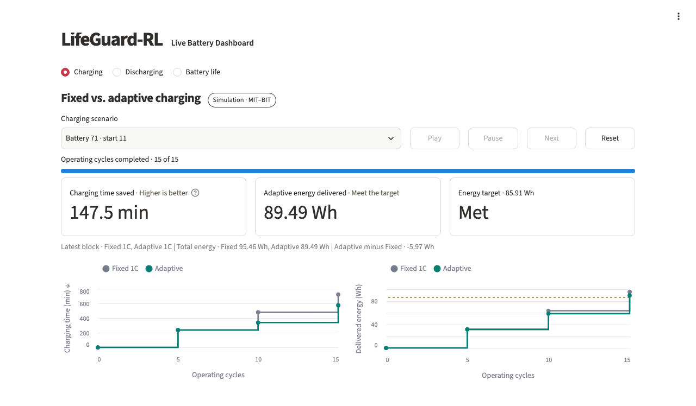
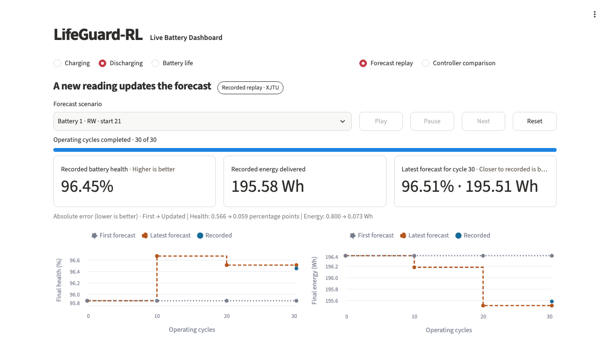
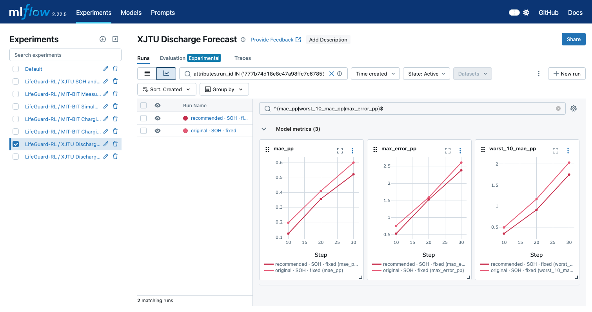

# LifeGuard-RL

**Battery health forecasting and energy-constrained control**

LifeGuard-RL estimates battery state of health (SOH) and remaining useful life (RUL), then compares charging and discharging decisions at a defined energy target. The capstone uses XJTU records from BatteryLife v12 for health, lifetime, and discharge studies, and MIT–BIT v3 records for adaptive charging. [System architecture](docs/architecture/svg/01-system-architecture.svg) · [Original research agenda](README_LifeGuard_RL.md)

## Run the demo

Start Docker and run this from the repository root. The image builds from the saved result exports in `reports/`, so reviewers can open the demo without downloading the raw datasets.

```sh
docker compose --profile demo up --build presentation
```

Open [Streamlit on port 8501](http://127.0.0.1:8501/) and use **Play** or **Next** to advance. Stop the service with `Ctrl+C`.



**Charging simulation.** Select **Charging → Battery 71 · start 11** and press **Next** three times. Fixed-budget MPC saves **147.5 minutes** in this scenario and delivers **89.49 Wh** against an **85.91 Wh** target. The fixed 1C comparison delivers **95.46 Wh**. [Presenter walkthrough](docs/live-presentation.md)

### Prediction output and inference

Select **Discharging → Forecast replay → Battery 1 · RW · start 21**. Advance through 10, 20, and 30 operating cycles. The dashboard shows the original forecast, the forecast updated with new readings, and the recorded outcome. **Battery life** replays SOH and estimated remaining cycles.



**Recorded replay.** In the case shown, the updated forecast reduces absolute SOH error from **0.566 to 0.059 pp** and delivered-energy error from **0.800 to 0.073 Wh**. These are single-case errors. The benchmark table below summarizes the matched evaluation windows.

The app loads saved predictions and simulated trajectories. To rebuild the JSON replay bundle from the same exports, run the following from the project root with Python 3.12. To generate new benchmark predictions, execute the corresponding notebooks in the training section.

```sh
python -B -m app.data /tmp/lifeguard-demo-data.json
```

For a local Streamlit launch, use a Python environment with [the app requirements](app/requirements.txt) installed.

```sh
python -B -m streamlit run app/app.py --server.address=127.0.0.1 \
  --server.headless=true --server.fileWatcherType=none --browser.gatherUsageStats=false
```

## Inspect evaluation in MLflow

Build the tracking image and initialize its Docker volume from the repository's saved exports. Then start the foreground service.

```sh
docker compose build lifeguard
docker compose run --rm --volume "$(pwd -P)/reports:/app/reports:ro" lifeguard \
  python -m tracking --store /var/lib/lifeguard/mlflow import
docker compose up lifeguard
```

Open [MLflow on port 5501](http://127.0.0.1:5501/) or the [static simulation dashboard](http://127.0.0.1:5501/simulation/). In a second terminal, print the URL for the chart shown below.

```sh
docker compose exec lifeguard python -m tracking --store /var/lib/lifeguard/mlflow \
  charts discharge-soh --port 5501
```



**Held-out forecast evaluation.** The three charts compare mean absolute error, maximum error, and the mean error of the worst 10% of windows. The x-axis represents forecast horizon in operating cycles. The tracker also stores model settings, evidence tags, source tables, plots, and available training histories. [Tracking implementation](tracking/) · [Tracking and migration details](README_LifeGuard_RL.md#local-mlflow-demo)

## Main results

MAE means mean absolute error. SOH error is in percentage points (pp) and RUL error is in cycles.

| Task | Selected approach | Verified result |
| --- | --- | --- |
| Current SOH and rolling RUL | **Notebook 11** rolling forecasts | Current SOH MAE **0.045 pp (2C)** and **0.044 pp (3C)**. RUL MAE **7.36** and **12.64 cycles**, respectively. [Results](reports/lifeguard_rolling_forecasts_results/summary.md) |
| Full SOH curve from cycle 100 | **Notebook 12** revised fixed forecast | Charge-based full-curve MAE **0.576 pp (2C)** and **1.141 pp (3C)**. [Results](reports/lifeguard_fixed_soh_forecast_results/summary.md) |
| Charging time and energy forecast | **Notebook 22** fold-selected forecast corrections, mainly Kernel Ridge | At 15 cycles, charging-time MAE **7.767 → 3.882 min** and delivered-energy MAE **1.411 → 0.921 Wh**. [Results](reports/lifeguard_mit_bit_charging_sac_results/summary.md) |
| Discharge SOH and energy forecast | **Notebook 23** horizon-specific models | For the same 149 endpoints at 30 cycles, the MAE changes from **0.520 pp / 0.909 Wh** at the start to **0.122 pp / 0.260 Wh** after refreshing at cycle 20 with recorded measurements. [Results](reports/lifeguard_xjtu_discharge_forecast_sac_results/summary.md#revised-forecasts-on-the-same-held-out-windows) |
| Charging controller | **Notebook 18** fixed-budget MPC | In the disturbance benchmark, MPC met the energy target in **97.27%** of simulated episodes. Discrete SAC met it in **92.12%**. [Controller comparison](reports/lifeguard_mit_bit_charging_sac_results/summary.md#controller-simulation-on-164-matched-starts) |
| Discharge controller | **Notebook 23** Original Lookahead | Mean simulated SOH loss was **1.755 pp** versus **1.984 pp** for the fixed template. Both met the energy target in **99.61%** of episodes. [Controller comparison](reports/lifeguard_xjtu_discharge_forecast_sac_results/summary.md#controller-outcomes) |

## Train and reproduce the notebooks

Prepare a Python 3.12 notebook environment if needed. If you already have a Python Work environment, point `PROJECT_PYTHON` to that interpreter and install only the missing packages.

```sh
uv venv --python 3.12 .venv
PROJECT_PYTHON="$(pwd -P)/.venv/bin/python"
uv pip install --python "$PROJECT_PYTHON" jupyterlab nbconvert ipykernel \
  numpy pandas scipy scikit-learn matplotlib threadpoolctl
"$PROJECT_PYTHON" -m ipykernel install --user --name lifeguard-rl --display-name "Python (LifeGuard-RL)"
"$PROJECT_PYTHON" -m jupyterlab
```

Open the notebook, select **Python (LifeGuard-RL)**, and use **Run All**. Notebooks 20–23 also use PyTorch. Install the policy-study dependencies before running those notebooks.

```sh
uv pip install --python "$PROJECT_PYTHON" torch cloudpickle "gymnasium==1.2.2"
```

### Train the first SOH benchmark

Put `XJTU.zip` and `XJTU_labels.json` from the life-label archive under `Dataset/`. If more than one copy exists, set the notebook's `INPUT_ROOT` to the intended input directory. Keep `MODE = "benchmark"` and `RUN_DUAL_GPU = False` for the CPU model comparison. [BatteryLife v12 downloads](https://zenodo.org/records/21149533)

```sh
"$PROJECT_PYTHON" -m nbconvert --to notebook --execute \
  --ExecutePreprocessor.kernel_name=lifeguard-rl --ExecutePreprocessor.timeout=-1 \
  --output-dir=/tmp/lifeguard-notebook-runs notebooks/01-xjtu-soh-kaggle.ipynb
```

Notebook 01 fits the Ridge and gradient-boosting baselines on held-out cell splits and saves predictions, metrics, and plots. The `nbconvert` output directory holds the executed notebook. Each notebook's own output settings control where its result exports are written. Later notebooks default to `reports/`, so use a separate checkout when keeping the saved benchmark exports intact. [Notebook execution options](https://nbconvert.readthedocs.io/en/latest/execute_api.html)

### Reproduce the selected approaches

The prerequisite exports are included in `reports/`. For example, regenerate the rolling SOH and RUL predictions using the same project kernel.

```sh
"$PROJECT_PYTHON" -m nbconvert --to notebook --execute \
  --ExecutePreprocessor.kernel_name=lifeguard-rl --ExecutePreprocessor.timeout=-1 \
  --output-dir=/tmp/lifeguard-notebook-runs notebooks/11-xjtu-rolling-forecasts.ipynb
```

Notebook 11 exports `soh_predictions.csv` and `rul_predictions.csv`. Use the notebook-specific launch instructions to set alternate dataset or output paths when needed.

| Notebook | Inputs | Output |
| --- | --- | --- |
| [11 · Rolling SOH and RUL](notebooks/11-xjtu-rolling-forecasts.ipynb) | Saved XJTU exports from Notebooks 01, 05–10 | SOH and RUL predictions, coverage, and errors |
| [12 · Fixed SOH forecast](notebooks/12-xjtu-fixed-soh-forecasts.ipynb) | Saved exports from Notebooks 01 and 06–09 | Fixed SOH curves and late-life errors |
| [18 · Charging MPC](notebooks/18-mit-bit-energy-budget-controller.ipynb) | Saved MIT–BIT exports from Notebooks 14, 16, and 17 | Block-level simulated actions, time, energy, and budget hits |
| [22 · Charging forecasts and SAC](notebooks/22-mit-bit-charging-forecast-sac.ipynb) | Notebook 14, 16, 17, and 18 exports plus MIT–BIT v3 workbooks under `Dataset/MIT-BIT` or their ZIP | Charging forecasts and a controller comparison |
| [23 · Discharge forecasts and controllers](notebooks/23-xjtu-discharge-forecast-sac.ipynb) | Notebook 19–21 exports plus `Dataset/XJTU` or `XJTU.zip` | Forecast and controller results. Set `RERUN_CONTROLLER_BENCHMARK = True` to recompute the controller comparison. |

Use the publisher's original cell folder names for MIT–BIT. The [dataset audit](docs/dataset_audit.md) explains the XJTU cell selection and end-of-life labels. [MIT–BIT v3 downloads](https://data.mendeley.com/datasets/kw34hhw7xg/3)

## Course techniques used

| Technique | Where it appears |
| --- | --- |
| Time-series feature engineering | [Notebook 01](notebooks/01-xjtu-soh-kaggle.ipynb) extracts cycle features from charging traces and uses measured discharge capacity to define SOH labels. |
| Classical regression and model selection | [Notebook 01](notebooks/01-xjtu-soh-kaggle.ipynb) compares Ridge and histogram gradient boosting. [Notebook 22](notebooks/22-mit-bit-charging-forecast-sac.ipynb) evaluates Kernel Ridge corrections. |
| Held-out validation and error analysis | [Notebook 11](notebooks/11-xjtu-rolling-forecasts.ipynb) evaluates rolling SOH and RUL by battery and charge rate. [Notebook 23](notebooks/23-xjtu-discharge-forecast-sac.ipynb) uses nested leave-one-battery-out forecast selection. |
| Digital-twin simulation | [Notebook 17](notebooks/17-mit-bit-multiblock-simulator.ipynb) validates charging transitions and [Notebook 20](notebooks/20-xjtu-discharge-ppo-pilot.ipynb) implements the discharge simulator with supported-action checks. |
| Receding-horizon control | [Notebook 18](notebooks/18-mit-bit-energy-budget-controller.ipynb) implements fixed-budget MPC. [Notebook 23](notebooks/23-xjtu-discharge-forecast-sac.ipynb) compares the Original Lookahead planner with other policies. |
| Reinforcement learning | [PPO](notebooks/20-xjtu-discharge-ppo-pilot.ipynb), [Fitted Q Iteration](notebooks/21-xjtu-forecast-fqi-benchmark.ipynb), and [Discrete SAC](notebooks/22-mit-bit-charging-forecast-sac.ipynb) are policy benchmarks. |
| Experiment tracking | [MLflow import and chart views](tracking/) preserve run metrics, source artifacts, and evidence tags. |
| Interactive serving and containerization | [Streamlit](app/app.py) serves the replay. [Docker Compose](compose.yaml) configures the demo and MLflow services. |

## Limitations and possible improvements

| Limitation | Possible improvement |
| --- | --- |
| Evaluation uses small laboratory cohorts. Some model settings were refined on the same cohorts used in the reported comparisons. | Validate on independent cells and hold out entire battery chemistries. |
| Simulators use a finite set of supported actions and model short operating horizons. | Collect measured outcomes for additional actions, then revalidate transition errors and operating constraints before expanding the action space. |
| RUL errors are larger in 3C cells. One 2C cell had no verified end-of-life event. | Report calibrated RUL intervals and evaluate methods that account for right-censored cells. |
| Controller benchmarks measure simulated time, energy delivery, and health loss. | Run prospective cycling experiments at matched energy targets before estimating real-world lifetime gains. |
