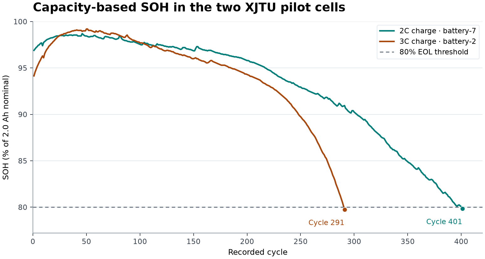

# LifeGuard-RL Dataset Audit and Pilot Cell Selection

**23 November 2026 · BatteryLife v12 · Zenodo DOI 10.5281/zenodo.21149533**

Start with **`XJTU_2C_battery-7`**. Add **`XJTU_3C_battery-2`** for the two-cell pilot. Both are 2.0 Ah LISHEN NCM523/graphite 18650 cells tested at room temperature. They share a 1C discharge protocol to 2.5 V and differ in their assigned CC–CV charge rate. Their recorded capacity curves cross 80% state of health (SOH) at the published end-of-life (EOL) cycles, so the same pair can test trace cleaning, SOH calculation, remaining useful life (RUL) labels, and a first comparison of charging protocols. [XJTU collection notes](../READMEs/XJTU_README.md) · [Original XJTU study](https://pmc.ncbi.nlm.nih.gov/articles/PMC11109204/)

BatteryLife v12 supports the health, lifetime, degradation, and generalisation studies in the [research agenda](../README_LifeGuard_RL.md). It can also calibrate and test a simulator on recorded protocols. The main RL hypothesis remains conditional on the simulator's ability to predict outcomes when the policy changes actions. The first two cells each follow a fixed protocol throughout life, so they provide no within-cell evidence about switching between the two charge rates.

## The two pilot cells

Both files are already in `XJTU.zip`, under the archive's `XJTU/` directory. The lifetime labels are in [XJTU_labels.json](../Life%20labels/XJTU_labels.json).

| File inside the archive | Charge protocol | Recorded cycles and EOL label | Discharge capacity in cycle 1 → EOL | Example RUL at cycle 100 |
| --- | --- | --- | --- | ---: |
| `XJTU/XJTU_2C_battery-7.pkl` | 2C CC–CV | 1–401, EOL 401 | 1.938 → 1.597 Ah | 301 cycles |
| `XJTU/XJTU_3C_battery-2.pkl` | 3C CC–CV | 1–291, EOL 291 | 1.883 → 1.595 Ah | 191 cycles |

The two files contain **692 cycles and 4,633,980 time-series samples**. All cycles have aligned, finite arrays for current, voltage, time, and charge and discharge capacity. Time increases within each cycle, and cycle numbers are consecutive. Both files include protocol and nominal-capacity metadata. Temperature and internal resistance fields are empty throughout. The source reports room temperature as a test condition. The files occupy 38.6 MB compressed within the ZIP and 208.7 MB uncompressed.

For these two cells, calculate SOH as `100 × max(discharge_capacity_in_Ah) / 2.0` per full discharge cycle. The 80% threshold is **1.600 Ah**. The preceding cycles were still above that threshold at 1.601 and 1.603 Ah, respectively. Maxima over the recorded discharge capacity arrays match this collection's capacity convention. For example, integrating discharge power over the recorded time gives about 7.01 → 5.61 Wh for the 2C cell and 6.83 → 5.64 Wh for the 3C cell from cycle 1 to EOL. These are derived trace values. [BatteryLife capacity conventions](https://github.com/Ruifeng-Tan/BatteryLife/blob/main/assets/Further_details_of_processed_charge_and_discharge_capacity_data.md) · [BatteryLife benchmark task definition](https://arxiv.org/html/2502.18807#S2.SS2)

The 2C cell sits at its group's median published lifetime of 401 cycles. The 3C cell's 291 cycles are close to its group's median of 285. Both have observed threshold crossings, and their traces avoid the large voltage spike seen in another candidate, `XJTU_2C_battery-1`. The selected traces still peak at 4.2032 V and 4.2002 V near the documented 4.2 V cutoff. Preserve these readings and flag deviations when defining simulator constraints. The 110-cycle difference describes these two cells. Estimate a protocol-level difference using the **8 cells at 2C and 15 at 3C**, with uncertainty measured across cells.

### Why XJTU is the first collection

| Collection | Best role in this project | What shapes the pilot choice |
| --- | --- | --- |
| **XJTU** | Simple charging comparison and a path from fixed protocols to within-cell discharge variation | The first two batches share cell design and discharge conditions, with a single charging-rate contrast. All 55 files are present and keyed to a lifetime label. |
| **MATR** | Fast-charging study with more protocol variety and extra measurements | The 169 LFP cells have 81 charging protocols under a common discharge protocol. The sampled files include temperature and resistance. Multistage protocols require more preprocessing. [MATR collection notes](../READMEs/MATR_README.md) |
| **HUST** | Discharge-protocol analysis and LFP validation | The 77 LFP cells share a charging protocol and have 77 multistage discharge schedules. Sampled published lifetime labels extend beyond the available traces. [Dataset summary](https://arxiv.org/html/2502.18807#A1.SS3) |
| **CALCE** | Small SOH and RUL prototype with direct threshold checks | The sampled CS2 cells are compact and have complete traces through EOL. They share the same recorded charge and discharge rates, so that pair offers little leverage for the charging comparison. [CALCE collection notes](../READMEs/CALCE_README.md) |
| **CALB** | Industrial NMC and temperature transfer study | The 58 Ah prismatic cells use a different SOH reference and EOL threshold. The two sampled 25 °C files end at cycle 100, with published lifetime labels of 792 and 982. The 0 °C group uses accelerated aging. [CALB collection notes](../READMEs/CALB_README.md) |
| **ISU-ILCC** | Expanded study of rates and depth of discharge | The local archive has 240 files. Sampled initial capacities and protocol-dependent discharge windows make the reference-capacity audit important before pooling trajectories. [Original ISU-ILCC study](https://doi.org/10.1016/j.xcrp.2024.101891) |

## Feasibility of the five research problems

| Research problem | What BatteryLife supports | What the experiment must establish |
| --- | --- | --- |
| **1. Estimate battery health** | Compute capacity-based SOH and train estimators from earlier measurements or a partial voltage/current trace. Start with the fixed-discharge XJTU batches. | Use held-out cells for generalisation. Full-cycle discharge capacity defines the target, so keep it out of same-cycle estimator inputs. Use past capacity only when the prediction would have access to it. |
| **2. Analyse degradation conditions** | Compare the XJTU charge-rate groups first. MATR adds charge profiles, HUST adds discharge profiles, and CALB, SNL, and Tongji add operating-condition contrasts. | Compare within comparable cell designs and protocols, account for initial differences and batch effects, and quantify uncertainty across cells. For partial or mixed-rate cycles, use comparable diagnostic capacities or explicitly model test conditions. |
| **3. Predict RUL** | Use observed EOL for supervised baselines in cycles. The pilot can verify labels and run a chronological pipeline check at fixed observation points such as cycles 50 and 100. | Track observed, extrapolated, and right-censored outcomes. Train and score against confirmed observed events or use a survival model with verified censoring times. Assess a benchmark-compatible evaluation with published labels on its own terms. Keep EOL and future capacity out of inputs. |
| **4. Test cross-chemistry generalisation** | Evaluate cell holdouts in XJTU, then test on other Li-ion chemistries such as LFP. Sodium-ion and zinc-ion support broader cross-system tests after harmonisation. | Harmonise capacity references, units, and feature windows. Group by physical cell, retain per-chemistry counts and metrics, and report differences in source, format, and protocol alongside chemistry. CALB is industrial NMC Li-ion. |
| **5. Test adaptive control in simulation** | Calibrate a transition model for recorded protocols and validate held-out fixed-protocol trajectories. Later XJTU batches contain within-cell discharge variation and some reference performance tests. | Establish action coverage at comparable health states and validate model rollouts before comparing policies. Fixed 2C and 3C trajectories cannot identify what happens when a cell switches charging rates midlife. Near-zero-current samples within a cycle give limited support for a discretionary rest action. |

### End-of-life labels and reference capacity

The benchmark generally uses 80% of nominal capacity, with collection-specific exceptions. CALB uses 90% of initial capacity. The zinc-ion collection documents a cycle-10 capacity reference. BatteryLife also publishes some extrapolated crossing labels. Local examples include `HUST_1-6`, whose released trace stops at 1,143 with a label of 1,179, and `XJTU_2C_battery-4`, whose trace stops at 395 with a label of 396. Store the published label, last observed cycle, threshold, reference capacity, and verified event status independently. For truncated releases, the end of the available trace and the end of the original experiment can be different dates or cycle indices. [BatteryLife experimental setup and label policy](https://arxiv.org/html/2502.18807#S4.SS1) · [Zinc-ion collection notes](../READMEs/ZN-coin_README.md)

### What to validate before training RL

1. Fit a simple capacity-transition baseline for each fixed protocol. Compare it with persistence and a trend baseline on entirely held-out cells. Report one-step and multi-step errors at fixed horizons, such as 10 and 50 cycles, alongside discharge-energy error. Evaluate over early- and mid-life states.
2. Audit the dynamic XJTU batches for changes in realized current and their support across health states. Use the `Cycling` and `RPT` attributes to distinguish operating cycles from reference performance tests. In `XJTU_Sim_satellite_battery-1`, for example, the first operating cycle delivers 0.111 Ah from a partial cycle. Its ratio to nominal capacity is unsuitable as a health label.
3. Test a narrow action set only where that model validates. Use the same energy-service requirement for fixed, rule-based, greedy, and RL controllers. Report energy delivered, capacity fade, and the uncertainty of the simulated difference. Treat observed protocol settings as the domain of the experiment and enforce its constraints independently of reward. Full thermal and hardware safety validation needs measurements and specifications beyond the pilot files.
4. If the data only support selecting a fixed charging protocol, evaluate that selection as a fixed-protocol comparison or one-time optimisation. A validated discharge-only simulation is another viable scope if the dynamic batches support it. Real-world lifetime extension requires prospective testing. Household demand, tariffs, outages, and solar generation fall outside the cycling dataset.

## Local release inventory

All **20 local ZIP archives match the MD5 checksums** published for Zenodo v12. The 18 archives containing cells take up **31.93 GB compressed**, with **92.00 GB** of pickle contents. The other two archives contain documentation and labels. The publisher's **990 batteries** describes the original benchmark. The v12 archives include **1,414 pickle entries**, representing **1,376 distinct cell filenames** after removing 38 duplicated Stanford entries. The public v12 announcement also lists a separate 123-cell Farasis collection on Hugging Face. It sits outside the downloaded Zenodo inventory and this pilot. The official Hugging Face card lists the processed dataset under MIT and asks users to cite BatteryLife and the contributing studies. [Zenodo v12 files and checksums](https://zenodo.org/records/21149533#files) · [Publisher's original benchmark counts](https://github.com/Ruifeng-Tan/BatteryLife#highlights) · [v12 release notes](https://github.com/Ruifeng-Tan/BatteryLife/blob/main/assets/Version12_Update_Details.md) · [Official processed dataset card](https://huggingface.co/datasets/Battery-Life/BatteryLife_Processed)

| Archive | Cell entries | With matching published label |
| --- | ---: | ---: |
| CALB | 27 | 27 |
| CALCE | 13 | 13 |
| HNEI | 14 | 14 |
| HUST | 77 | 77 |
| ISU_ILCC | 240 | 240 |
| MATR | 169 | 169 |
| MICH | 40 | 40 |
| MICH_EXP | 18 | 12 |
| NA-ion | 64 | 34 |
| RWTH | 48 | 48 |
| SDU | 86 | 70 |
| SNL | 61 | 52 |
| Stanford | 41 | 41 |
| Stanford_2 | 181 | 181 |
| Tongji | 130 | 108 |
| UL_PUR | 10 | 2 |
| XJTU | 55 | 55 |
| ZN-coin | 140 | 121 |
| **Total archive entries** | **1,414** | **1,304** |
| **After removing the Stanford overlap** | **1,376** | **1,266** |

Tongji filenames in the ZIP use `--` where the label keys use `-#`. Applying that mapping to the Tongji join recovers all 108 label matches. The 38 overlapping Stanford entries share names, ZIP CRCs, and published label values. The `total_MICH_labels.json` file is a combined index for MICH and MICH_EXP. A label match confirms that a numeric label exists. Review the trace to determine event status before including it in RUL scoring. For example, the unlabeled `SNL_18650_LFP_25C_0-100_0.5-1C_a` ends at 0.944 Ah against a nominal 1.1 Ah, above the 80% threshold.

The inventory used ZIP member listings and label-key joins. I checked cycle IDs, array lengths, finite values, within-cycle timestamps, and label alignment in all 55 XJTU files and spot-checked seven other collections. XJTU has 27,595 recorded cycles. Its five core traces passed those structural checks across all 55 files, and temperature and resistance are empty throughout. In the two fixed-protocol batches, 22 of 23 cells have a recorded capacity at or below 1.600 Ah at the published label cycle. Measurement quality and event status in other collections still need per-cell verification.

## First experiment

Use `XJTU_2C_battery-7` to build the cycle-level table and reproduce the SOH curve and EOL label. Run the same pipeline on `XJTU_3C_battery-2` as an independent input and compare the curves. With these two cells, a chronological holdout can check that forecasts and RUL targets are constructed without future data. For a performance result, expand to all 23 fixed-protocol XJTU cells. Split by cell with each protocol represented, fit a persistence or trend baseline and a simple regression baseline, and report SOH and observed-event RUL errors by protocol. Expand to the dynamic batches after those baselines are established.
